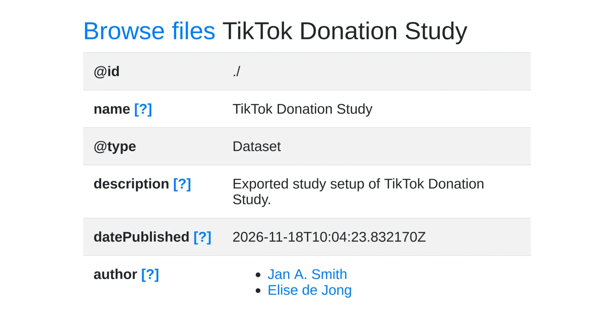

If you run a data donation study with Port on [Next](https://next.eyra.co), you can now export your study setup as an RO-Crate with one click. The export packages everything that participants see, including information pages, consent, instructions, and tasks into a single documentation package. This makes your study easier to archive and reproduce.

## How to export your study

Open your study in Next, click the **⋮** menu at the top right next to **Publish** and choose **Export**. Your browser downloads a .zip file with the name of your study. 

 and choose Export (2). The blue button next to it reads Preview or Finish up, depending on whether your study has been live.")

## What's in the package

```plain
my_study/
├── next-metadata.json
├── ro-crate-metadata.json
└── assets/
    ├── logo.png
    ├── privacy-statement.pdf
    └── instruction-step-1-1-1.png
```

- **next-metadata.json** holds the study setup itself: branding (title, subtitle, logo), the About and Helpdesk pages, the consent text, and the workflow: each task in order, such as questionnaires, instruction manuals, documents and the data donation task.
- **assets/** contains the files the setup refers to: your logo, privacy statement, documents and the images in your instruction manuals.
- **ro-crate-metadata.json** describes the package: what it is, who made it, when it was exported, where it came from and under which licence it may be reused

## Why RO-Crate

The package is a research object built on [RO-Crate](https://www.researchobject.org/ro-crate/) (Research Object Crate), an open standard for describing research outputs with structured metadata. Repositories and tools that understand RO-Crate can read who created your study, when it was exported, and where it came from (its provenance) without opening the files.



All of this supports the FAIR principles: Findable, Accessible, Interoperable and Reusable. You can store the export with your data, add it to a repository, or share it with reviewers and colleagues.

## Together with script selector

The setup export captures your study as it runs on Next. The donation flow itself and its codebook come from the [script selector](/software/script-selector/) package. Together the pair provide everything required to run the study again. 

## What's next

We are working on a broader framework for FAIR data donation studies and will share more about it in a future update.

This development was funded by [SSHOC-NL](https://sshoc.nl/).
