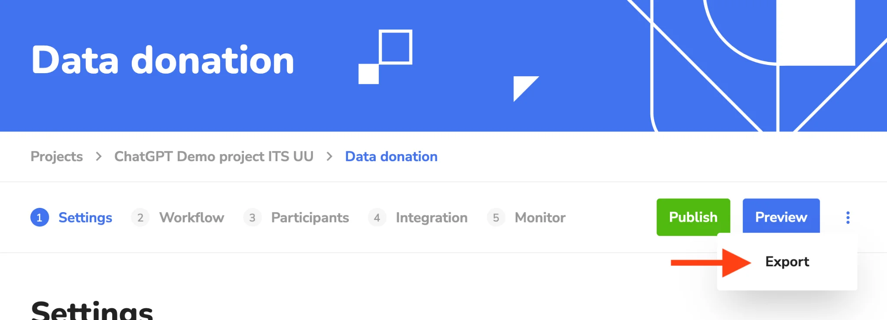
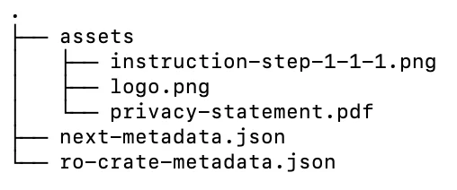

If you run a data donation study with Port, you can now export your study setup from Next as an RO-Crate.

When you use Port to run a data donation study on Next, you can now export the study's settings and materials. Open your study, click the three-dot menu next to Publish and Preview, and choose Export.

 

The export is a .zip file. It contains your study configuration (branding, information pages, consent and workflow tasks) and related files such as your logo, privacy statement and instruction images. These are packaged as a research object using RO-Crate (Research Object Crate), an open standard for describing research outputs with structured metadata. The metadata records who created the study, when it was exported, where it came from and under which licence it can be reused. You can read more about RO-Crate at researchobject.org/ro-crate ([https://www.researchobject.org/ro-crate/](https://www.researchobject.org/ro-crate/)).

The export documents where your study came from (its provenance) and makes it easier for others to reproduce. This supports the FAIR principles: Findable, Accessible, Interoperable and Reusable. You can store the export with your data, add it to a repository, or share it with reviewers and colleagues.

We are also working on a broader framework for FAIR data donation studies and will share more about it in a future update!

This development was funded by SSHOC-NL ([https://sshoc.nl/](https://eur04.safelinks.protection.outlook.com/?url=https%3A%2F%2Fsshoc.nl%2F&data=05%7C02%7Cd.shanidze%40uva.nl%7Ca7b33455e3eb41ca039d08df365e328e%7Ca0f1cacd618c4403b94576fb3d6874e5%7C0%7C0%7C639289450357744369%7CUnknown%7CTWFpbGZsb3d8eyJFbXB0eU1hcGkiOnRydWUsIlYiOiIwLjAuMDAwMCIsIlAiOiJXaW4zMiIsIkFOIjoiTWFpbCIsIldUIjoyfQ%3D%3D%7C0%7C%7C%7C&sdata=3SDY0lBlqcmUC6fZ%2BaAllEE9h40ZiUtFGGj5rybWl2M%3D&reserved=0)).
