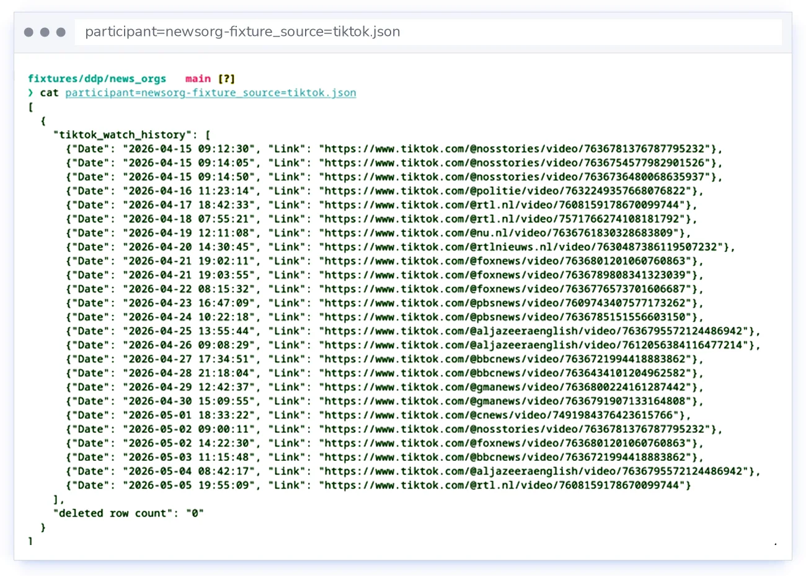
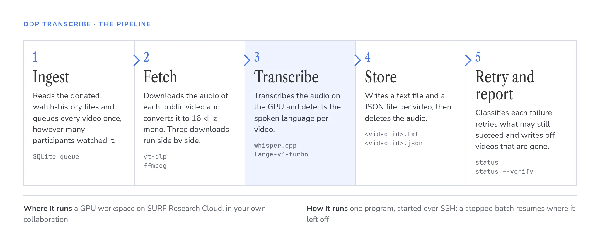

Watch histories from participant donations contain a list of dates and links which tell you what videos a participant watched. Most researchers who collect watch histories are interested in exposure data, which requires enriching the data after it's donated. DDP Transcribe provides this functionality by generating transcriptions for the set of URLs.

## How it works

After exporting the donations from Next, put them on a secure server like Yoda or Research Drive and link it, or upload them directly into a folder on the workspace. The pipeline runs five steps, and all transcription is handled locally:

1. **Ingest.** It reads the files and queues each video once, however many participants watched it. You can limit a run to a period of viewing.
2. **Fetch.** It downloads the audio of each public video with yt-dlp and converts it with ffmpeg.
3. **Transcribe.** It transcribes the audio on the GPU with whisper.cpp and the large-v3-turbo model, and detects the language of each video.
4. **Store.** It writes the transcript and deletes the audio. No audio or video is kept.
5. **Retry and report.** It classifies each failure, retries what may still succeed and writes off videos that are gone. One command shows the counts.

A batch that stops, for any reason, resumes where it left off.

## What comes back

For every video you get two files, named after the video ID. The text file holds the transcript. The JSON file holds the link to the video, its duration, the detected language, the model and the time of transcription. It also holds the probability Whisper gave to every token, so you can set your own threshold for which transcripts to trust. The pipeline also keeps what the platform showed for each video at the time of fetching: the description, the uploader and the numbers of views, likes and comments.

You can read the transcripts in DDP Inspector, next to the donated watch history.

## What a study needs

- The watch-history files from your data donation study.
- A collaboration on SURF Research Cloud that can start a GPU workspace.

## Beside DDP Inspector and DDP Comments

DDP Transcribe is one of three tools on SURF Research Cloud that start from the same donated watch history. [DDP Comments](/news/2026-11-23-zeeschuimer-integration-now-available-for-donation-enrichment/) collects the comments under the same videos, with student collectors and 4CAT. DDP Inspector shows the donations and the transcripts in the browser, read-only.

## Getting access

DDP Transcribe runs on SURF Research Cloud, in your own collaboration. To use it for a study, email [DataDonation@uu.nl](mailto:DataDonation@uu.nl).
