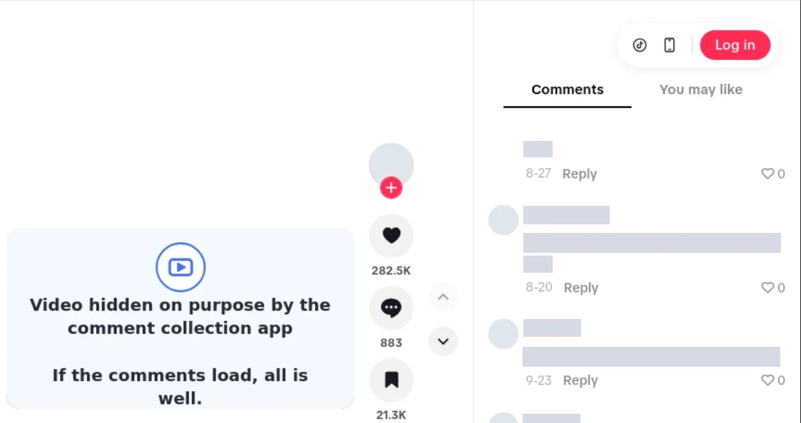
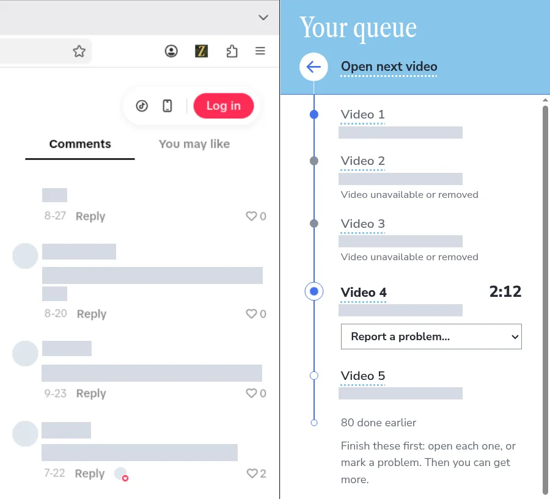
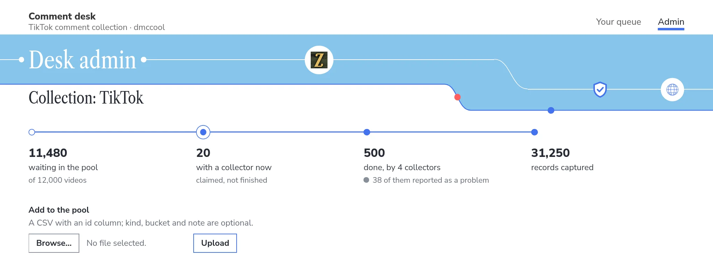
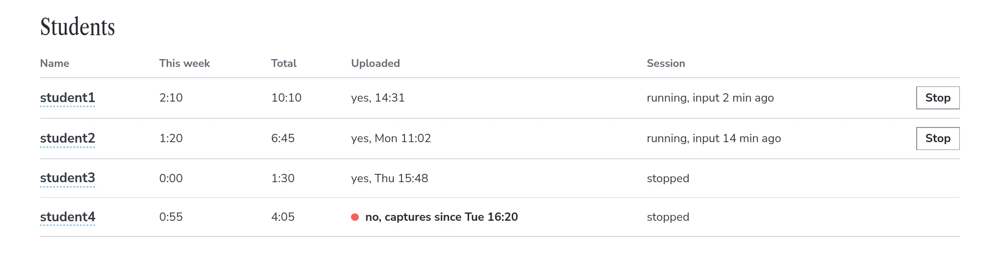
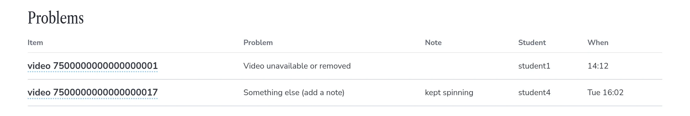

A donated TikTok history tells you which videos a participant watched, liked or commented on, but it doesn't contain exposure information about what was in the videos or the comments attached to them. DDP Comments is a tool that provides a straightforward way to integrate data donation studies with [Zeeschuimer](https://github.com/digitalmethodsinitiative/zeeschuimer) for comment collection that starts from the video IDs in the donations.

DDP Comments can be started as a workspace on SURF Research Cloud and integrates with the Surf SRAM Collaboration system for access. Your own collectors, for example student assistants, sign in with their institutional account and work through a shared list of videos, in a browser that runs on the workspace. What they collect goes to a local instance of [4CAT](https://4cat.nl/), where you can then combine and export it.

 opens a video in the browser on the left, where the video is hidden (2) and the collector opens the comments (3). A timer (4) counts down. Zeeschuimer (5) records the comments, and a note (6) says whether they have reached 4CAT. Names, comment text and video IDs are covered in this picture.")

## How it works

1. Upload the combined list of video IDs on the admin page. The list holds IDs only, in shuffled order. Nothing in it says who donated which video.
2. A collector clicks **Open next video**. The desk hands out videos from the list at random, a few at a time.
3. The video page opens in the collector's browser. The video can optionally be hidden, and every image represented as a plain block, so collectors do don't have to be exposed to any sensitive content. No TikTok account is used.
4. The collector opens the comments and scrolls until no more load, or until the timer runs out. [Zeeschuimer](https://github.com/digitalmethodsinitiative/zeeschuimer), a browser extension from the Digital Methods Initiative, records the comments as they load.
5. If a video has been removed, is private, needs a login or is not available in the region, the collector picks that reason from a list and goes on to the next one.
6. When they're finished collecting, they send the captured comments through to the local database.

## What you see as a study lead

The admin page shows the collection as it stands: how many videos are waiting, how many are with a collector, how many are done and how many records have been captured. You add videos to the list on the same page.

For each collector you can see who's active in the system, and whether or not they've uploaded their data to the database.

Videos that could not be collected are listed with the reason.

## What a study needs

- A collaboration on SURF Research Cloud, with a group for your collectors and a group for study leads, and budget for a workspace with a storage volume.
- A list of TikTok video IDs as a CSV file. A tool that comes with DDP Comments makes this list from the donations you export from Next.
- People to collect. Every video is opened by a person.

## Beside DDP Transcribe and DDP Inspector

DDP Comments is one of three tools on SURF Research Cloud that work with donated data. [DDP Transcribe](/news/2026-11-23-ddp-transcribe/) fetches the videos in the donated watch histories and transcribes what is said in them. DDP Inspector shows the donations and the transcripts in the browser, read-only.

## Getting access

DDP Comments runs on SURF Research Cloud, in your own collaboration. To use it for a study, email [DataDonation@uu.nl](mailto:datadonation@uu.nl).

The code is on [GitHub](https://github.com/daniellemccool/researchcloud-ddp-comments).
